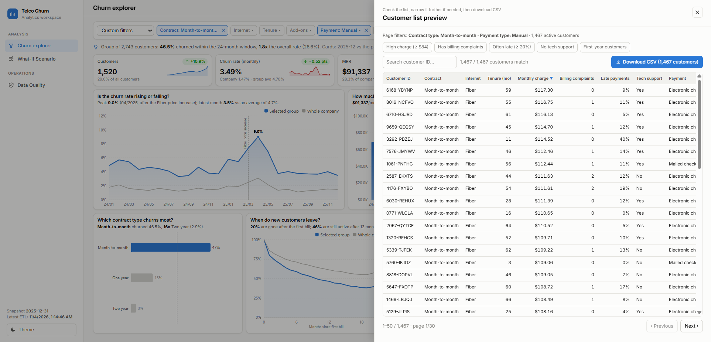
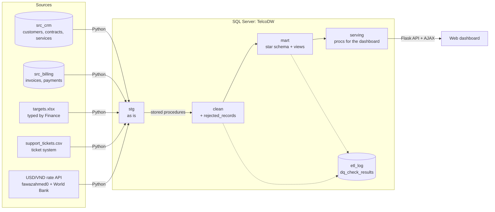
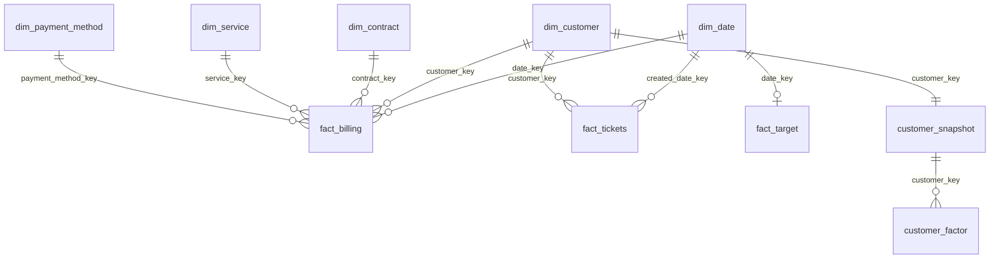

# Telco Churn Analytics

A data analyst portfolio project on customer churn at a telecom operator, from messy source data to a dashboard for
decisions. Data from four kinds of sources (CRM, Billing, Excel/CSV, API) is loaded into **SQL Server**, cleaned with
**stored procedures**, modelled as a **star schema**, checked automatically for quality, and served in an
**interactive web dashboard**: switch factors on and off to see their effect on churn and revenue.

Base data: [IBM Telco Customer Churn](https://www.kaggle.com/datasets/blastchar/telco-customer-churn) (7,043 customers, 21 columns).
Every number in this README comes from a query in this repository, run on this pipeline.


## Summary

| | |
|---|---|
| **SQL & data model** | `TelcoDW` warehouse with 3 layers `stg -> clean -> mart`; star schema with 2 facts + 5 dimensions; 7 analysis query files, one question each |
| **ETL & cleaning** | Idempotent stored procedures with a log row per step; 10 kinds of data error handled; bad rows kept with a reason instead of silently deleted |
| **Data quality** | 26 automatic checks after every run: 24 pass, 2 known warnings, 0 failures; amount totals reconciled to 0.01 USD |
| **Analysis** | Monthly KPIs vs target, churn drivers, controlled comparison, cohort retention, risk segments, what-if; anomaly detection validated against a planted event |
| **Dashboard** | 3 pages; the main page fits one screen, every chart answers one question, Power BI-style cross-filtering, customer list preview then CSV download |
| **Engineering** | One SQL call per interaction (no N+1), no dynamic SQL, server-side paging, columnstore indexes, cache per ETL batch |

## Key findings

These come from the customer attributes of the base data and hold up regardless of the simulated timeline.

| Question | Answer from the data |
|---|---|
| What is churn most associated with? | **Contract and add-on services.** Month-to-month customers churned 42.7% within the 24-month window vs 2.9% on two-year contracts. Customers with no add-on service churned 52.2% vs 5.3% with all six |
| Does Fiber churn more because of price, or only because Fiber customers are more often month-to-month? | **Fiber is a risk factor of its own.** Within the same contract type, Fiber still churns 1.7-3.7 times more than DSL, while costing 34-37 USD/month more |
| Where do churned customers come from? | **Fiber makes up 69%** of all churners (1,297/1,869), because it both churns more and is the largest group |
| Which group should retention focus on? | **"Month-to-month, Fiber, manual payment"**: 21.4% of customers but **48.9%** of the expected monthly MRR loss |
| When do customers leave? | **Early.** Of each new cohort, 86.1% are still billed after the first month and 61.1% after 12 months. 597 of the 1,869 churners (32%) left within their first three bills |

## Recommendations with numbers

| # | Recommendation | Estimate from the data |
|---|---|---|
| 1 | A 10% discount for month-to-month customers who move to a one-year contract, aiming for 20% (444 customers) | **137 more customers** and **59,162 USD** more revenue over 12 months; **27,545 USD** net of the discount; breaks even below an 18.7% discount |
| 2 | Move "month-to-month, Fiber, manual payment" customers to automatic payment (the same group paying automatically churns 2.78%/month vs 5.46%) | If 50% of the 617 customers switch: **~8 fewer churners** and **~721 USD less MRR lost per month** |
| 3 | An onboarding programme for the first 90 days (welcome call, first-bill explanation), since a third of churners leave within three bills | Early exits cost **~25 customers and ~1,518 USD of MRR per month**. Preventing one in four of them (an assumption to test) keeps ~6 customers and ~380 USD of MRR per month |

The estimates come from differences between customer groups (correlation, not causation), so treat them as **upper bounds**.
Each needs an A/B test with a control group before a full rollout.

## Method check on planted signals

Part of the data is simulated (see [Synthetic data](#synthetic-data-and-assumptions)). The simulation plants a few
signals on purpose, so the analysis can be checked against a known answer. They are **not** business findings.

| Planted in the simulation | What the analysis recovered |
|---|---|
| A 15% Fiber price increase in 2025-03 ([src/config.py](src/config.py)) | The anomaly view, which is not told the month, flags 2025-04 churn at 3.10% (z = 3.28) and 2025-03 billing tickets at 285 vs a mean of 90 (z = 3.69). MRR rose 8.0% (+23,796 USD) in 2025-03 |
| Billing complaints peaking one month before churn | Recovered (tickets peak 2025-03, churn 2025-04), but the lag was set by hand and event tickets are drawn for every Fiber customer regardless of who churns, so this does **not** show that tickets predict churn |
| Churn targets set at 90% of actual 2024 churn | Churn is above target in 19 of 24 months, as designed; the point is the target tracking, not the miss |
| A billing outage in 2024-08 | The data quality checks find the missing month without being told which one |

The simulation only changes **when** Fiber churners leave, not **how many**, so this data cannot measure the net churn
cost of the price increase. That would need a control group (for example a region without the increase).

## Dashboard

Flask + ECharts web app, used instead of Power BI (not installed on the development machine). Every metric is computed in SQL; the UI only displays it.

**Churn explorer** (image at the top): a Power BI-style report page that fits one screen.
- **One-row filter bar:** 13 factors (contract, internet, tenure, add-ons, payment...) plus saved views such as "High-risk group". The picker shows each option's churn rate. Filters live in the URL, so a view can be shared as a link.
- **Each chart answers one question:** line 1 is the question, line 2 the answer computed for the current filters. For example *"Which contract type churns most?"* -> *"Month-to-month churned 46.5%, 16x Two year"*.
- **Retention curve** for "when do new customers leave", instead of churn by tenure band, which is biased: a churner's tenure stops at the exit month while active customers keep ageing.
- **Five KPI cards, one template:** latest month, change vs the previous month, 24-month trend. Churn is labelled per month; the summary line uses the 24-month window.
- **Cross-filtering:** click a bar or a donut slice to filter, click again to remove; the selected option stays solid, the others fade.
- **"Which factor makes the biggest difference?" panel:** ranks the factors, each with tiles for the option that churns most and least; click to filter.

**View & download CSV:** reuses the page filters. The preview can be narrowed further (high charge, billing complaints, often late,
no tech support, first-year customers), searched, sorted and paged; the download exports exactly the rows shown.



| What-if Scenario: moving customers to a one-year contract | Data Quality: 26 checks, rejected records, ETL steps |
|---|---|
|  |  |

Page design and the question -> metric -> query -> chart mapping: [docs/03_dashboard_spec.md](docs/03_dashboard_spec.md).

## Architecture



| Layer | Role | Load method |
|---|---|---|
| `stg` | As-is copy of the sources, plus `stg_row_id`, `load_date`, `source_system` | Python, full reload every run |
| `clean` | Normalised, de-duplicated, key-checked. Bad rows go to `clean.rejected_records` with a reason and the full original row (JSON) | Stored procedures, TRUNCATE + INSERT in a transaction |
| `mart` | Star schema, analysis views, tables serving the dashboard | Dimensions: MERGE (SCD1, stable keys). Facts: full reload |

Every procedure is **idempotent** (re-running gives the same result) and writes to `dbo.etl_log`. Verified:
re-running or rebuilding from scratch gives the same `fact_billing` checksum.

### Star schema



| Table | Grain | Rows |
|---|---|---:|
| `fact_billing` | 1 customer x 1 billed month (USD/VND charge, exit-month flag, payment status) | 227,990 |
| `fact_tickets` | 1 ticket | 10,689 |
| `fact_target` | 1 month (churn and MRR targets) | 24 |
| `dim_date` | 1 day, 2018-2025 | 2,922 |
| `dim_customer` / `dim_contract` / `dim_service` / `dim_payment_method` | customer / contract type x paperless billing / service combination / payment method | 7,043 / 6 / 322 / 4 |
| `customer_snapshot` | 1 customer: current profile + aggregated behaviour, for the dashboard | 7,032 |
| `customer_factor` | 1 customer x 1 factor: bridge table for dynamic filtering | 91,416 |

Keys, relationships and cleaning rules: [docs/02_data_warehouse.md](docs/02_data_warehouse.md).

## Injected data errors and how they are handled

| Error | Count | Handling |
|---|---:|---|
| Duplicate `customer_id` (the CRM has no primary key; some differ only by whitespace) | 45 | TRIM, keep the latest `updated_at`, the rest go to rejected |
| Yes/Y/yes/1 and No/N/no/0 mixed | 1,694 | Normalised to BIT; unknown values go to rejected |
| Extra whitespace in keys and category columns | 910 | TRIM. Detected with `DATALENGTH` because SQL Server ignores trailing spaces in `=` comparisons |
| Dates in 4 formats (`yyyy-mm-dd`, `dd/mm/yyyy`, `yyyymmdd`, `dd-Mon-yyyy`) | 7,300 | Dedicated parser, independent of the session language; 0 rows unreadable |
| Negative amounts | 120 | Sign flipped; verified that 116/116 paid invoices match the amount paid exactly |
| NULL amounts | 150 | 148 recovered from payments, 2 estimated from the previous invoice |
| Invoices for customers missing from CRM | 53 (8 IDs) | Rejected; the 53 matching payments are rejected too |
| A month with no invoices at all (billing outage 2024-08) | 4,573 | Found by the quality checks without being told the month. `fact_billing` takes its month calendar from CRM and estimates the amount (0.007% off the true total) |
| Excel: header on row 4, column names differ between the 2 sheets (in Vietnamese), 2 month formats, churn typed in % | 24 rows | Columns identified by name pattern, reads both Excel dates and `Tmm/yyyy`, converts % to a ratio |
| Blank TotalCharges (present in the base data) | 11 | Kept as NULL, only valid when tenure = 0 |

**26 quality checks** run at the end of every ETL run: `stg = clean + rejected` for 8 tables, error counts before/after
cleaning, CRM-Billing key reconciliation, amount totals stg -> clean -> mart. Result: **24 pass, 2 warnings** (both the
known billing outage month), **0 failures**.

## Technical decisions

| Problem | Approach | Reason |
|---|---|---|
| The dashboard must respond quickly to filter changes | Each change calls **1 stored procedure** (`mart.usp_explore`) that returns several result sets in one round trip | Avoids N+1; charts that share a grain share a result set instead of one query per chart |
| Arbitrary filters on 13 factors | Bridge table `customer_factor` + filters passed as JSON (`OPENJSON`) | No dynamic SQL: plans are reused and there is no path for SQL injection |
| Aggregate queries on the facts | Columnstore indexes on `fact_billing`, `fact_tickets`, `customer_factor` | The factor impact step dropped from ~260 ms to ~35 ms; a full call ~290 ms, ~2 ms on a cache hit |
| The customer list can reach thousands of rows | Filtering, quick filters, sorting, paging (`OFFSET/FETCH`) and CSV generation on the server | Only 50 rows per call; the sort column comes from an allow-list, bad parameters return 400 |
| No page reloads | SPA calling the API with `fetch`, merging rapid clicks, cancelling stale requests | Smooth interaction without bursts of requests |
| Connection security | Windows Authentication, server name from an environment variable; `.env` in `.gitignore` | No password or API key anywhere in the code |
| External reference data | Exchange rates from real APIs; if an API fails the load step reports FAILED instead of using made-up numbers | Every number can be traced to a source |

## Synthetic data and assumptions

The base data is only a **single snapshot**: `Churn = Yes` means the customer left in the snapshot month, so there is
no trend over time. Everything below is **synthetic**, derived from the base data with a fixed seed (`RANDOM_SEED = 42`,
byte-identical on every run). No customer is duplicated or upsampled.

- **Timeline:** snapshot 2025-12-31. Exit months are spread over 2024-01..2025-12 with mild seasonality. Signup month = exit month (or snapshot) - tenure.
- **Planted event:** in 03/2025 the Fiber price rises 15%, and Fiber churners are made more likely to leave in 03-05/2025. The number of Fiber churners does not change, only their timing.
- **Invoices and payments:** amount = MonthlyCharges ± 2%; the chance of paying late depends on the payment method and rises sharply in the 3 months before leaving.
- **Tickets:** more frequent without tech support, with Fiber, before leaving, and during the price increase.
- **Finance targets:** derived from actuals at a moderately demanding level.
- **Exchange rates:** **real** data from public APIs (daily from 03/2024, World Bank annual averages before that).
- **To keep in mind:** no customer churns before 2024 (survivorship bias), so every churn metric is only analysed within **2024-01..2025-12**.

Details: [docs/01_data_generation.md](docs/01_data_generation.md).

## Run it from scratch

**Requirements:** Windows; SQL Server (Developer/Express, 2016 SP1 or later) running locally with Windows Authentication;
ODBC Driver 17 for SQL Server; Python 3.11+; Internet access (exchange rate API).

```bash
pip install -r requirements.txt
python -m src.run_pipeline --fresh   # generate sources -> stg -> clean/mart -> quality checks (~1.5 minutes)
python -m src.dashboard.app          # open http://127.0.0.1:5000
```

Change the server or driver with the environment variables `TELCO_SQL_SERVER`, `TELCO_SQL_DRIVER`. Steps can also run one at a time:
`python -m src.generate_sources`, `python -m src.load_staging`, `python -m src.run_etl [--rebuild]`.
The analysis queries in `sql/analysis/` run directly in SSMS.

## Project structure

```
data/                 base data + source/ (generated source files, injected_errors.csv)
src/
  generate/           generate the source data and inject errors
  fx/client.py        exchange rate API client
  load_staging.py     load the 4 sources into stg
  run_etl.py          deploy SQL + run dbo.usp_run_etl
  run_pipeline.py     run everything
  dashboard/          Flask API + UI
sql/
  ddl/                stg/clean/mart schemas, etl_log, source systems
  etl/                stored procedures stg -> clean -> mart
  quality/            26 data quality checks (dbo.usp_run_dq_checks)
  views/              analysis views
  serving/            stored procedures for the dashboard (dynamic filters, customer list)
  analysis/           7 analysis questions, each file with its insights
docs/                 documentation per stage, dashboard screenshots
```

## Limitations

- Most of the data is synthetic, derived from one snapshot; the time trend and the price event are simulated.
- Group comparisons are correlations; the causal effect of each factor is not separated (the brief excluded ML models).
- The dashboard runs locally and needs Internet access to load the chart library and font.
