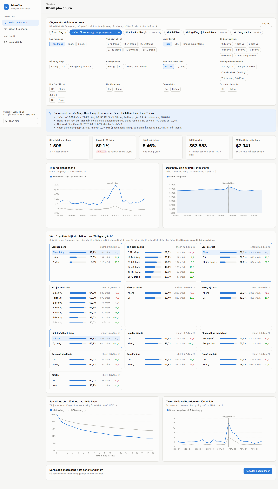
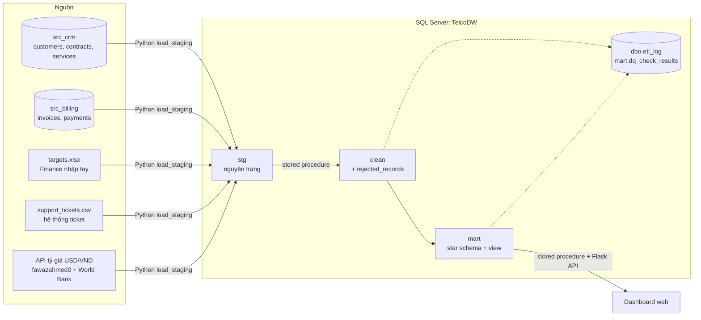
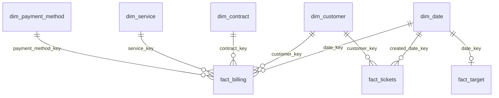
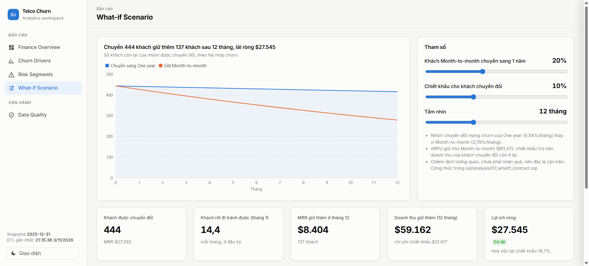
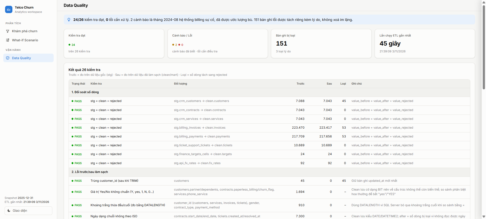

# Telco Churn Analytics: từ dữ liệu nguồn lộn xộn đến dashboard ra quyết định

Dự án portfolio Data Analyst: dựng một pipeline phân tích churn khách hàng viễn thông hoàn chỉnh trên **SQL Server**.
Dữ liệu đi từ 4 loại nguồn (CRM, Billing, file Excel/CSV, API), qua ETL bằng **stored procedure** vào **star schema**,
được kiểm tra chất lượng tự động, rồi lên **dashboard web tương tác**: bật/tắt yếu tố để xem tác động lên churn và doanh thu.

Nền dữ liệu: [IBM Telco Customer Churn](https://www.kaggle.com/datasets/blastchar/telco-customer-churn)
(7.043 khách, 21 cột). Mọi con số trong README đều lấy từ truy vấn chạy thật trên pipeline này.



## Câu hỏi kinh doanh

1. Churn và MRR theo tháng có đạt chỉ tiêu không? Churn làm mất bao nhiêu doanh thu định kỳ?
2. Yếu tố nào gắn với churn cao (hợp đồng, tenure, loại internet, dịch vụ đi kèm, thanh toán)?
3. Fiber churn cao hơn DSL thật, hay chỉ vì khách Fiber hay dùng hợp đồng tháng?
4. Khách được giữ lại bao lâu sau khi ký (cohort retention)?
5. Tháng nào bất thường, và có tín hiệu cảnh báo sớm không?
6. Nhóm khách nào vừa đông, vừa churn cao, vừa đóng góp MRR lớn? Cụ thể là những khách nào?
7. Nếu chuyển một phần khách hợp đồng tháng sang hợp đồng 1 năm thì giữ lại được bao nhiêu doanh thu?

## Kiến trúc



| Tầng | Vai trò | Cách nạp |
|---|---|---|
| `stg` | Bản sao nguyên trạng, thêm `stg_row_id`, `load_date`, `source_system` | Python, full reload |
| `clean` | Chuẩn hoá, loại trùng, đối chiếu khoá. Dòng lỗi vào `clean.rejected_records` kèm lý do và JSON gốc, **không xoá im lặng** | Stored procedure, TRUNCATE + INSERT trong transaction |
| `mart` | Star schema cho phân tích | Dimension: MERGE (SCD1, khoá ổn định). Fact: nạp lại toàn bộ |

Mọi procedure **idempotent** và ghi `dbo.etl_log`. Đã kiểm chứng: chạy lại hay dựng lại từ đầu
đều cho cùng checksum `fact_billing`.

### Star schema



| Bảng | Grain | Số dòng |
|---|---|---:|
| `fact_billing` | 1 khách × 1 tháng có tính cước (amount USD và VND, `is_churn_month`, trạng thái thanh toán) | 227.990 |
| `fact_tickets` | 1 ticket | 10.689 |
| `fact_target` | 1 tháng (chỉ tiêu churn và MRR) | 24 |
| `dim_date` | 1 ngày, 2018–2025, dùng làm Date table | 2.922 |
| `dim_customer` / `dim_contract` / `dim_service` / `dim_payment_method` | khách / loại hợp đồng × paperless / tổ hợp dịch vụ (junk dimension) / phương thức thanh toán | 7.043 / 6 / 322 / 4 |

Chi tiết khoá, quan hệ và quy tắc làm sạch: [docs/02_data_warehouse.md](docs/02_data_warehouse.md).

## Phần synthetic và giả định

Bộ dữ liệu gốc chỉ là **ảnh chụp tại một thời điểm**: `Churn = Yes` nghĩa là khách rời đi trong tháng chụp,
nên không có xu hướng theo thời gian. Mọi phần dưới đây là **synthetic**, dẫn xuất từ dữ liệu gốc với seed cố định
(`RANDOM_SEED = 42`, chạy lại cho ra đúng từng byte). Không có khách nào bị nhân bản hay upsample.

- **Dòng thời gian:** snapshot 2025-12-31. Khách churn được rải tháng rời đi trong 2024-01..2025-12, có mùa vụ nhẹ.
  Tháng ký = tháng rời đi (hoặc snapshot) − tenure. Hoá đơn tính sau, nên mỗi khách có đúng `tenure` hoá đơn.
- **Sự kiện cài sẵn:** 2025-03 giá Fiber tăng 15%, khiến churn nhóm Fiber tăng trong 03–05/2025.
- **Hoá đơn và thanh toán:** amount = MonthlyCharges ± 2%. Xác suất trễ hạn phụ thuộc phương thức thanh toán và tăng mạnh ở 3 tháng trước khi rời đi.
- **Ticket:** tăng khi khách không có TechSupport, dùng Fiber, sắp rời đi, và khi có đợt tăng giá (khiếu nại hoá đơn).
- **Chỉ tiêu Finance:** dẫn xuất từ số thực tế cho thách thức vừa phải (churn = 90% thực tế năm 2024, năm 2025 giảm thêm 8%).
- **Tỷ giá:** dữ liệu **thật** từ API công khai. Từ 03/2024 là tỷ giá theo ngày (fawazahmed0); trước đó là bình quân năm (World Bank), vì nguồn ngày không có lịch sử cũ hơn.
- **Hệ quả cần nhớ:** trước 2024 không có khách churn (survivorship bias), nên mọi chỉ số churn chỉ phân tích trong cửa sổ **2024-01..2025-12**.

Chi tiết: [docs/01_data_generation.md](docs/01_data_generation.md).

## Lỗi dữ liệu đã cài và cách xử lý

| Lỗi | Số lượng | Xử lý |
|---|---:|---|
| Trùng `customer_id` (CRM không có khoá chính; một phần lệch nhau do khoảng trắng) | 45 | TRIM rồi giữ bản `updated_at` mới nhất, phần còn lại → rejected |
| Yes/Y/yes/1, No/N/no/0 lẫn lộn | 1.694 | Chuẩn hoá về BIT; giá trị lạ → rejected |
| Khoảng trắng thừa ở khoá và cột phân loại | 910 | TRIM. Phát hiện bằng `DATALENGTH` vì SQL Server **bỏ qua khoảng trắng cuối khi so sánh `=`** |
| Ngày lẫn 4 định dạng (`yyyy-mm-dd`, `dd/mm/yyyy`, `yyyymmdd`, `dd-Mon-yyyy`) | 7.300 | Hàm parse riêng, không phụ thuộc ngôn ngữ phiên; 0 dòng không đọc được |
| Amount âm | 120 | Đảo dấu; kiểm chứng 116/116 hoá đơn đã thanh toán khớp đúng số tiền thanh toán |
| Amount NULL | 150 | 148 lấy từ payment, 2 ước lượng từ hoá đơn liền trước |
| Hoá đơn của khách không có trong CRM | 53 (8 ID) | → rejected; 53 payment đi kèm cũng bị loại |
| Một tháng thiếu toàn bộ hoá đơn (sự cố billing 2024-08) | 4.573 | Data quality tự phát hiện mà không cần biết trước tháng nào. `fact_billing` lấy lịch tháng từ CRM và ước lượng amount = trung bình tháng trước/sau (lệch 0,007% so với số thật) |
| Excel: tiêu đề ở dòng 4, tên cột khác nhau giữa 2 sheet, tháng 2 kiểu, churn ghi theo % | 24 dòng | Nhận diện cột theo mẫu tên, parse cả ngày Excel lẫn `Tmm/yyyy`, đổi % thành tỷ lệ |
| TotalCharges rỗng (lỗi có sẵn trong dữ liệu gốc) | 11 | Giữ NULL, chỉ hợp lệ khi tenure = 0 |

Bộ **26 kiểm tra chất lượng** chạy cuối mỗi batch, gồm: đối soát `stg = clean + rejected` cho 8 bảng, đếm lỗi trước/sau làm sạch,
đối chiếu khoá CRM–Billing, và tổng tiền stg → clean → mart (khớp tới 0,01 USD). Kết quả: **24 PASS, 2 WARN** (cả hai đều là tháng sự cố billing đã biết), **0 FAIL**.

## Insight chính

1. **Churn vượt chỉ tiêu 19/24 tháng** (9/12 tháng năm 2024, 10/12 tháng năm 2025), bình quân 1,66%/tháng so với chỉ tiêu 1,39% rồi 1,28%.
2. **Hợp đồng và dịch vụ đi kèm là driver mạnh nhất.** Month-to-month churn 42,7% so với Two year 2,9%. Khách không dùng add-on nào churn 52,2%, khách dùng đủ 6 add-on chỉ 5,3%. Khách năm đầu (tenure 0–12 tháng) churn 47,7%.
3. **Fiber là yếu tố rủi ro riêng, không chỉ do cơ cấu hợp đồng.** Trong cùng loại hợp đồng, Fiber vẫn churn gấp 1,7–3,7 lần DSL, trong khi cước cao hơn 34–37 USD/tháng.
4. **Đợt tăng giá Fiber bị phát hiện tự động và có tín hiệu báo trước.** Churn 04/2025 đạt 3,10% (z = 3,28); ticket Billing tăng vọt 03/2025 (z = 3,69), sớm hơn đỉnh churn 1 tháng. Tăng giá kéo MRR thêm 23.796 USD/tháng, nhưng churn vượt mức bình thường trong 03–05/2025 lấy đi 13.925 USD MRR định kỳ, tức khoảng 59% phần tăng thêm.
5. **Rủi ro tập trung vào một phân khúc.** "Month-to-month, Fiber, trả tay" chiếm 21,4% khách nhưng gánh **48,9%** MRR dự kiến mất mỗi tháng (2.941/6.011 USD).

## Đề xuất có định lượng

| # | Đề xuất | Ước lượng (từ dữ liệu) |
|---|---|---|
| 1 | Ưu đãi 10% cho khách Month-to-month ký hợp đồng 1 năm, mục tiêu chuyển đổi 20% (444 khách) | Doanh thu giữ thêm **59.162 USD/12 tháng**, lợi ích ròng sau chiết khấu **27.545 USD**; hoà vốn nếu chiết khấu dưới 18,7% |
| 2 | Chuyển khách phân khúc "Month-to-month, Fiber, trả tay" sang thanh toán tự động (cùng phân khúc nhưng trả tự động thì churn chỉ 2,78% so với 5,46%/tháng) | Nếu 50% trong 617 khách chuyển: tránh **~8 khách rời đi** và **~721 USD MRR mất mỗi tháng** |
| 3 | Theo dõi ticket Billing hằng tuần làm cảnh báo sớm; lần sau tăng giá thì thông báo trước và có gói giữ chân | Đợt tăng giá vừa qua mất 13.925 USD MRR do churn vượt mức; ticket báo trước đỉnh churn 1 tháng |

Các ước lượng dựa trên chênh lệch tương quan giữa các nhóm khách, chưa phải quan hệ nhân quả, nên là **cận trên**.
Cần thử nghiệm A/B có nhóm đối chứng trước khi triển khai rộng.

## Dashboard

Web app Flask + ECharts thay cho Power BI, gồm 3 trang:

- **Khám phá churn:** bật/tắt 13 yếu tố (một hay nhiều cùng lúc) hoặc chọn góc nhìn có sẵn. Mọi KPI, xu hướng, retention, bảng "yếu tố nào tạo khác biệt lớn nhất" và danh sách khách (xuất CSV) tính lại ngay theo nhóm đang chọn, luôn so với toàn công ty, kèm insight viết bằng câu thường.
- **What-if Scenario:** thanh trượt tỷ lệ chuyển hợp đồng, chiết khấu, tầm nhìn.
- **Data Quality:** 26 kiểm tra, bản ghi bị loại, các bước ETL.

**Hiệu năng:** mỗi lần đổi bộ lọc chỉ gọi 1 stored procedure (1 round-trip, không N+1), bộ lọc truyền dạng JSON (không SQL động).
Kỹ thuật dùng: bảng cầu nối khách × yếu tố, columnstore index, cache theo batch ETL. Kết quả: ~290 ms cho bộ lọc mới, ~2 ms khi trúng cache.
Chi tiết: [docs/03_dashboard_spec.md](docs/03_dashboard_spec.md).

| What-if Scenario | Data Quality |
|---|---|
|  |  |

## Chạy lại từ đầu

**Yêu cầu:** Windows, SQL Server (Developer/Express; columnstore cần bản 2016 SP1 trở lên) chạy local với Windows Authentication, ODBC Driver 17 for SQL Server, Python 3.11+, kết nối Internet (gọi API tỷ giá).

```bash
pip install -r requirements.txt
python -m src.run_pipeline --fresh   # sinh nguồn -> stg -> clean/mart -> data quality (~1,5 phút)
python -m src.dashboard.app          # mở http://127.0.0.1:5000
```

Đổi server hoặc driver bằng biến môi trường `TELCO_SQL_SERVER` và `TELCO_SQL_DRIVER`. Có thể chạy từng bước riêng:
`python -m src.generate_sources`, `python -m src.load_staging`, `python -m src.run_etl [--rebuild]`.
Truy vấn phân tích trong `sql/analysis/` chạy trực tiếp trên SSMS.

## Cấu trúc thư mục

```
data/                 WA_Fn-UseC_-Telco-Customer-Churn.csv (gốc), source/ (file nguồn sinh ra + injected_errors.csv)
src/
  generate/           sinh dữ liệu nguồn và cài lỗi (giai đoạn 1)
  fx/client.py        gọi API tỷ giá
  load_staging.py     nạp 4 nguồn vào stg (giai đoạn 2)
  run_etl.py          deploy SQL + chạy dbo.usp_run_etl (giai đoạn 3)
  run_pipeline.py     chạy toàn bộ
  dashboard/          Flask API + giao diện (giai đoạn 5)
sql/
  ddl/                schema stg/clean/mart, etl_log, hệ thống nguồn
  etl/                stored procedure stg -> clean -> mart
  quality/            dbo.usp_run_dq_checks
  views/              view phân tích
  serving/            stored procedure cho trang Khám phá (lọc động)
  analysis/           7 câu hỏi phân tích, mỗi file có insight
docs/                 tài liệu từng giai đoạn, ảnh dashboard
```
