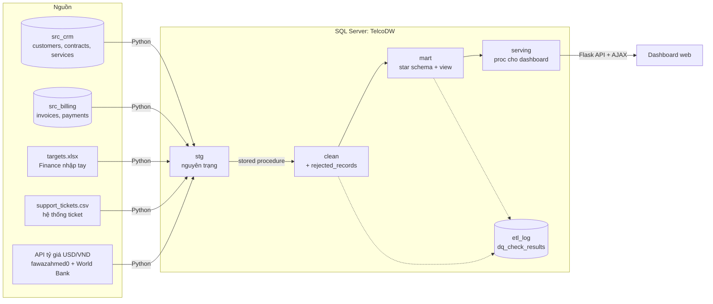
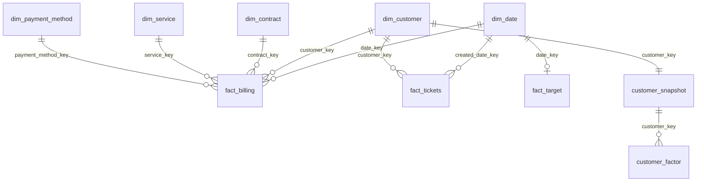

# Telco Churn Analytics

Dự án portfolio Data Analyst: phân tích khách hàng rời mạng (churn) của một nhà mạng viễn thông, từ dữ liệu nguồn lộn xộn
đến dashboard để ra quyết định. Dữ liệu từ 4 loại nguồn (CRM, Billing, Excel/CSV, API) được nạp vào **SQL Server**,
làm sạch bằng **stored procedure**, mô hình hoá thành **star schema**, kiểm tra chất lượng tự động, rồi đưa lên một
**dashboard web tương tác**: bật/tắt yếu tố để xem tác động lên tỷ lệ rời đi và doanh thu.

Nền dữ liệu: [IBM Telco Customer Churn](https://www.kaggle.com/datasets/blastchar/telco-customer-churn) (7.043 khách, 21 cột).
Mọi con số trong README đều lấy từ truy vấn chạy thật trên pipeline này.


## Tóm tắt

| | |
|---|---|
| **SQL & mô hình dữ liệu** | Kho `TelcoDW` 3 tầng `stg → clean → mart`; star schema 2 fact + 5 dimension; 7 file truy vấn phân tích, mỗi file trả lời một câu hỏi |
| **ETL & làm sạch** | Stored procedure idempotent, ghi log từng bước; 10 loại lỗi dữ liệu được xử lý, dòng lỗi giữ lại kèm lý do chứ không xoá im lặng |
| **Chất lượng dữ liệu** | 26 kiểm tra tự động sau mỗi lần chạy: 24 đạt, 2 cảnh báo đã biết, 0 lỗi; tổng tiền đối soát khớp tới 0,01 USD |
| **Phân tích** | KPI theo tháng so với chỉ tiêu, driver churn, phân tích có kiểm soát, cohort retention, phát hiện bất thường (bắt được sự kiện tăng giá), phân khúc rủi ro, what-if |
| **Dashboard** | 3 trang; trang chính vừa một màn hình, mỗi biểu đồ trả lời một câu hỏi, lọc chéo kiểu Power BI, danh sách khách xem trước rồi tải CSV |
| **Kỹ thuật** | Mỗi thao tác chỉ 1 lượt gọi SQL (không N+1), không SQL động, phân trang ở server, columnstore index, cache theo batch ETL |

## Kết quả chính

| Câu hỏi | Trả lời từ dữ liệu |
|---|---|
| Churn có đạt chỉ tiêu không? | **Không.** Vượt chỉ tiêu 19/24 tháng; bình quân 1,66%/tháng so với chỉ tiêu 1,39% (2024) và 1,28% (2025) |
| Yếu tố nào gắn với churn cao? | **Hợp đồng và dịch vụ đi kèm.** Hợp đồng theo tháng rời đi 42,7%, hợp đồng 2 năm 2,9%. Không dùng dịch vụ đi kèm nào 52,2%, dùng đủ 6 dịch vụ 5,3%. Khách năm đầu 47,7% |
| Fiber rời đi nhiều vì giá hay chỉ vì hay dùng hợp đồng tháng? | **Fiber là yếu tố rủi ro riêng.** Trong cùng loại hợp đồng, Fiber vẫn rời đi nhiều gấp 1,7–3,7 lần DSL, trong khi cước cao hơn 34–37 USD/tháng |
| Khách rời đi đến từ đâu? | **Fiber chiếm 69%** tổng số khách rời đi (1.297/1.869), vì vừa rời đi nhiều vừa đông khách |
| Có tháng bất thường không? | **Có: đợt tăng giá Fiber 03/2025.** Churn 04/2025 đạt 3,10% (z = 3,28). Ticket khiếu nại hoá đơn tăng vọt từ 03/2025 (z = 3,69), sớm hơn đỉnh churn 1 tháng. Tăng giá kéo MRR thêm 23.796 USD/tháng, nhưng churn vượt mức bình thường lấy lại 13.925 USD, khoảng 59% phần tăng thêm |
| Nên ưu tiên giữ chân nhóm nào? | **"Hợp đồng tháng, Fiber, trả tay"**: 21,4% khách nhưng gánh **48,9%** MRR dự kiến mất mỗi tháng |
| Khách được giữ lại bao lâu? | Còn 86,1% sau tháng đầu và 61,1% sau 12 tháng. Rò rỉ lớn nhất là ngay sau kỳ cước đầu tiên |

## Đề xuất có định lượng

| # | Đề xuất | Ước lượng từ dữ liệu |
|---|---|---|
| 1 | Ưu đãi 10% cho khách hợp đồng tháng chuyển sang hợp đồng 1 năm, mục tiêu 20% (444 khách) | Giữ thêm **137 khách** và **59.162 USD** doanh thu trong 12 tháng; lợi ích ròng sau chiết khấu **27.545 USD**; hoà vốn nếu chiết khấu dưới 18,7% |
| 2 | Chuyển khách nhóm "hợp đồng tháng, Fiber, trả tay" sang thanh toán tự động (cùng nhóm nhưng trả tự động thì chỉ rời đi 2,78%/tháng so với 5,46%) | Nếu 50% trong 617 khách chuyển: tránh **~8 khách rời đi** và **~721 USD MRR mất mỗi tháng** |
| 3 | Theo dõi ticket khiếu nại hoá đơn hằng tuần làm cảnh báo sớm; lần sau tăng giá thì báo trước và có gói giữ chân | Đợt tăng giá vừa qua mất 13.925 USD MRR do churn vượt mức; ticket báo trước đỉnh churn 1 tháng |

Các ước lượng dựa trên chênh lệch giữa các nhóm khách (tương quan, chưa phải nhân quả) nên là **mức tối đa**.
Cần thử nghiệm A/B có nhóm đối chứng trước khi triển khai rộng.

## Dashboard

Web app Flask + ECharts, thay cho Power BI (máy phát triển chưa cài Power BI). Mọi chỉ số tính trong SQL; giao diện chỉ hiển thị.

**Khám phá churn** (ảnh đầu trang): kiểu trang báo cáo Power BI, vừa một màn hình.
- **Thanh lọc một hàng:** 13 yếu tố (hợp đồng, internet, gắn bó, dịch vụ kèm, thanh toán...) cùng các góc nhìn có sẵn như "Nhóm rủi ro cao". Bảng chọn hiện sẵn tỷ lệ rời đi của từng lựa chọn. Bộ lọc lưu trên URL để gửi link.
- **Mỗi biểu đồ trả lời một câu hỏi:** dòng 1 là câu hỏi, dòng 2 là câu trả lời tự tính theo bộ lọc. Ví dụ: *"Loại hợp đồng nào dễ rời đi nhất?"* → *"Theo tháng rời đi 46,5%, gấp 16 lần 2 năm"*.
- **5 thẻ KPI cùng một khuôn:** số tháng gần nhất, thay đổi so với tháng trước, xu hướng 24 tháng.
- **Lọc chéo:** bấm một cột hoặc lát donut để lọc, bấm lại để bỏ; nhánh đang chọn tô đậm, nhánh khác làm mờ.
- **Panel "Yếu tố nào tạo khác biệt lớn nhất?":** xếp hạng 13 yếu tố, mỗi yếu tố có ô nhánh rời đi nhiều nhất / ít nhất, bấm để lọc.

**Xem & tải CSV:** dùng lại đúng bộ lọc trang. Khung xem trước cho thu hẹp thêm (cước cao, có khiếu nại hoá đơn, hay trả trễ,
không hỗ trợ kỹ thuật, khách năm đầu), tìm mã, sắp xếp, chuyển trang; nút tải xuất đúng những khách đang hiện.


| What-if Scenario: chuyển khách sang hợp đồng 1 năm | Data Quality: 26 kiểm tra, bản ghi bị loại, các bước ETL |
|---|---|
|  |  |

Thiết kế từng trang, bảng ánh xạ câu hỏi → chỉ số → truy vấn → biểu đồ: [docs/03_dashboard_spec.md](docs/03_dashboard_spec.md).

## Kiến trúc



| Tầng | Vai trò | Cách nạp |
|---|---|---|
| `stg` | Bản sao nguyên trạng của nguồn, thêm `stg_row_id`, `load_date`, `source_system` | Python, nạp lại toàn bộ mỗi lần |
| `clean` | Chuẩn hoá, loại trùng, đối chiếu khoá. Dòng lỗi vào `clean.rejected_records` kèm lý do và nguyên dòng gốc (JSON) | Stored procedure, TRUNCATE + INSERT trong transaction |
| `mart` | Star schema, view phân tích, bảng phục vụ dashboard | Dimension: MERGE (SCD1, khoá ổn định). Fact: nạp lại toàn bộ |

Mọi procedure **idempotent** (chạy lại bao nhiêu lần cũng cho cùng kết quả) và ghi `dbo.etl_log`. Đã kiểm chứng:
chạy lại hoặc dựng lại từ đầu đều cho cùng checksum `fact_billing`.

### Star schema



| Bảng | Grain | Số dòng |
|---|---|---:|
| `fact_billing` | 1 khách × 1 tháng có tính cước (cước USD/VND, cờ tháng rời đi, trạng thái thanh toán) | 227.990 |
| `fact_tickets` | 1 ticket | 10.689 |
| `fact_target` | 1 tháng (chỉ tiêu churn và MRR) | 24 |
| `dim_date` | 1 ngày, 2018–2025 | 2.922 |
| `dim_customer` / `dim_contract` / `dim_service` / `dim_payment_method` | khách / loại hợp đồng × hoá đơn điện tử / tổ hợp dịch vụ / phương thức thanh toán | 7.043 / 6 / 322 / 4 |
| `customer_snapshot` | 1 khách: hồ sơ hiện tại + hành vi tổng hợp, phục vụ dashboard | 7.032 |
| `customer_factor` | 1 khách × 1 yếu tố: bảng cầu nối cho lọc động | 91.416 |

Chi tiết khoá, quan hệ, quy tắc làm sạch: [docs/02_data_warehouse.md](docs/02_data_warehouse.md).

## Lỗi dữ liệu đã cài và cách xử lý

| Lỗi | Số lượng | Xử lý |
|---|---:|---|
| Trùng `customer_id` (CRM không có khoá chính; một phần lệch nhau do khoảng trắng) | 45 | TRIM rồi giữ bản `updated_at` mới nhất, phần còn lại vào rejected |
| Yes/Y/yes/1, No/N/no/0 lẫn lộn | 1.694 | Chuẩn hoá về BIT; giá trị lạ vào rejected |
| Khoảng trắng thừa ở khoá và cột phân loại | 910 | TRIM. Phát hiện bằng `DATALENGTH` vì SQL Server bỏ qua khoảng trắng cuối khi so sánh `=` |
| Ngày lẫn 4 định dạng (`yyyy-mm-dd`, `dd/mm/yyyy`, `yyyymmdd`, `dd-Mon-yyyy`) | 7.300 | Hàm parse riêng, không phụ thuộc ngôn ngữ phiên; 0 dòng không đọc được |
| Số tiền âm | 120 | Đảo dấu; kiểm chứng 116/116 hoá đơn đã thanh toán khớp đúng số tiền thanh toán |
| Số tiền NULL | 150 | 148 lấy từ thanh toán, 2 ước lượng từ hoá đơn liền trước |
| Hoá đơn của khách không có trong CRM | 53 (8 mã) | Vào rejected; 53 thanh toán đi kèm cũng bị loại |
| Một tháng thiếu toàn bộ hoá đơn (sự cố billing 2024-08) | 4.573 | Kiểm tra chất lượng tự phát hiện mà không cần biết trước tháng nào. `fact_billing` lấy lịch tháng từ CRM và ước lượng số tiền (lệch 0,007% so với số thật) |
| Excel: tiêu đề ở dòng 4, tên cột khác nhau giữa 2 sheet, tháng 2 kiểu, churn ghi theo % | 24 dòng | Nhận diện cột theo mẫu tên, đọc cả ngày Excel lẫn `Tmm/yyyy`, đổi % thành tỷ lệ |
| TotalCharges rỗng (lỗi có sẵn trong dữ liệu gốc) | 11 | Giữ NULL, chỉ hợp lệ khi tenure = 0 |

**26 kiểm tra chất lượng** chạy cuối mỗi lần ETL: đối soát `stg = clean + rejected` cho 8 bảng, đếm lỗi trước/sau làm sạch,
đối chiếu khoá CRM–Billing, tổng tiền stg → clean → mart. Kết quả: **24 đạt, 2 cảnh báo** (đều là tháng sự cố billing đã biết), **0 lỗi**.

## Quyết định kỹ thuật

| Vấn đề | Cách làm | Lý do |
|---|---|---|
| Dashboard phải phản hồi nhanh khi đổi bộ lọc | Mỗi lần đổi bộ lọc chỉ gọi **1 stored procedure** (`mart.usp_explore`), trả nhiều bộ kết quả trong một lượt | Tránh N+1; các biểu đồ dùng chung dữ liệu cùng mức chi tiết nên gom theo grain chứ không tách theo từng hình |
| Lọc tuỳ ý trên 13 yếu tố | Bảng cầu nối `customer_factor` + bộ lọc truyền dạng JSON (`OPENJSON`) | Không cần SQL động: kế hoạch thực thi được tái sử dụng và không có đường cho SQL injection |
| Truy vấn tổng hợp trên bảng fact | Columnstore index trên `fact_billing`, `fact_tickets`, `customer_factor` | Bước tính tác động yếu tố giảm từ ~260 ms xuống ~35 ms; cả lượt gọi ~290 ms, ~2 ms khi trúng cache |
| Danh sách khách có thể lên tới hàng nghìn dòng | Lọc, phân loại, sắp xếp, chia trang (`OFFSET/FETCH`) và tạo CSV đều ở server | Mỗi lần chỉ trả 50 dòng; cột sắp xếp chọn từ danh sách cho phép, tham số sai trả lỗi 400 |
| Không tải lại trang | SPA gọi API bằng AJAX (`fetch`), gộp cú bấm liên tiếp, huỷ request cũ | Thao tác mượt, không gửi hàng loạt request |
| Bảo mật kết nối | Windows Authentication, tên server lấy từ biến môi trường; `.env` nằm trong `.gitignore` | Không có mật khẩu hay khoá API nào trong code |
| Dữ liệu tham chiếu ngoài | Tỷ giá lấy từ API thật; API lỗi thì bước nạp báo FAILED, không thay bằng số giả | Mọi con số đều truy được về nguồn |

## Phần dữ liệu synthetic và giả định

Bộ dữ liệu gốc chỉ là **ảnh chụp tại một thời điểm**: `Churn = Yes` nghĩa là khách rời đi trong tháng chụp, nên không có
xu hướng theo thời gian. Phần dưới đây là **synthetic**, dẫn xuất từ dữ liệu gốc với seed cố định (`RANDOM_SEED = 42`,
chạy lại cho ra đúng từng byte). Không có khách nào bị nhân bản hay upsample.

- **Dòng thời gian:** snapshot 2025-12-31. Tháng rời đi được rải trong 2024-01..2025-12, có mùa vụ nhẹ. Tháng ký = tháng rời đi (hoặc snapshot) − tenure.
- **Sự kiện cài sẵn:** 03/2025 giá Fiber tăng 15%, làm churn nhóm Fiber tăng trong 03–05/2025.
- **Hoá đơn và thanh toán:** số tiền = MonthlyCharges ± 2%; xác suất trả trễ phụ thuộc phương thức thanh toán và tăng mạnh 3 tháng trước khi rời đi.
- **Ticket:** nhiều hơn khi khách không có hỗ trợ kỹ thuật, dùng Fiber, sắp rời đi, và khi có đợt tăng giá.
- **Chỉ tiêu Finance:** dẫn xuất từ số thực tế với mức thách thức vừa phải.
- **Tỷ giá:** dữ liệu **thật** từ API công khai (theo ngày từ 03/2024, bình quân năm của World Bank trước đó).
- **Hệ quả cần nhớ:** trước 2024 không có khách churn (thiên lệch sống sót), nên mọi chỉ số churn chỉ phân tích trong **2024-01..2025-12**.

Chi tiết: [docs/01_data_generation.md](docs/01_data_generation.md).

## Chạy lại từ đầu

**Yêu cầu:** Windows; SQL Server (Developer/Express, bản 2016 SP1 trở lên) chạy local với Windows Authentication;
ODBC Driver 17 for SQL Server; Python 3.11+; kết nối Internet (gọi API tỷ giá).

```bash
pip install -r requirements.txt
python -m src.run_pipeline --fresh   # sinh nguồn -> stg -> clean/mart -> kiểm tra chất lượng (~1,5 phút)
python -m src.dashboard.app          # mở http://127.0.0.1:5000
```

Đổi server hoặc driver bằng biến môi trường `TELCO_SQL_SERVER`, `TELCO_SQL_DRIVER`. Có thể chạy từng bước:
`python -m src.generate_sources`, `python -m src.load_staging`, `python -m src.run_etl [--rebuild]`.
Truy vấn phân tích trong `sql/analysis/` chạy trực tiếp trên SSMS.

## Cấu trúc thư mục

```
data/                 dữ liệu gốc + source/ (file nguồn sinh ra, injected_errors.csv)
src/
  generate/           sinh dữ liệu nguồn và cài lỗi
  fx/client.py        gọi API tỷ giá
  load_staging.py     nạp 4 nguồn vào stg
  run_etl.py          deploy SQL + chạy dbo.usp_run_etl
  run_pipeline.py     chạy toàn bộ
  dashboard/          Flask API + giao diện
sql/
  ddl/                schema stg/clean/mart, etl_log, hệ thống nguồn
  etl/                stored procedure stg -> clean -> mart
  quality/            26 kiểm tra chất lượng (dbo.usp_run_dq_checks)
  views/              view phân tích
  serving/            stored procedure cho dashboard (lọc động, danh sách khách)
  analysis/           7 câu hỏi phân tích, mỗi file có insight
docs/                 tài liệu từng giai đoạn, ảnh dashboard
```

## Giới hạn

- Phần lớn dữ liệu là synthetic dẫn xuất từ một ảnh chụp; xu hướng theo thời gian và sự kiện tăng giá là do mô phỏng.
- Các so sánh giữa nhóm khách là tương quan, chưa tách được tác động nhân quả của từng yếu tố (đề bài không dùng mô hình ML).
- Dashboard chạy local và cần Internet để tải thư viện biểu đồ và font.
