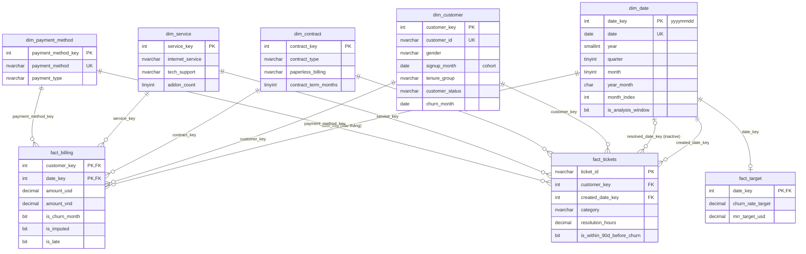

# Giai đoạn 2–3: Data Warehouse `TelcoDW`

## 1. Kiến trúc và cách chạy

```
src_crm / src_billing / targets.xlsx / support_tickets.csv / FX API
        │  python -m src.load_staging    (nạp nguyên trạng, full reload)
        ▼
stg.*   ──  EXEC dbo.usp_run_etl  (python -m src.run_etl [--rebuild])
        ▼
clean.* + clean.rejected_records      (chuẩn hoá, loại trùng, đối chiếu khoá)
        ▼
mart.*  (star schema)  +  mart.dq_check_results
```

| Schema | Vai trò | Cách nạp |
|---|---|---|
| `stg` | Bản sao nguyên trạng của nguồn, thêm `stg_row_id`, `load_date`, `source_system` | Full reload mỗi lần |
| `clean` | Dữ liệu đã làm sạch; dòng lỗi vào `clean.rejected_records` kèm lý do và JSON gốc | TRUNCATE + INSERT trong 1 transaction |
| `mart` | Star schema cho phân tích/Power BI | Dimension: MERGE (SCD1, khoá ổn định). Fact: TRUNCATE + INSERT |
| `dbo` | `etl_log` (mỗi bước 1 dòng), `etl_config` (snapshot_date, analysis_window_start) | |

Mọi stored procedure đều idempotent và ghi `etl_log`. Đã kiểm chứng: chạy lại không rebuild cho ra
cùng khoá dimension, cùng checksum `fact_billing`, cùng số bản ghi bị loại.

Mã nguồn: [sql/ddl/](../sql/ddl/), [sql/etl/](../sql/etl/), [sql/quality/](../sql/quality/).

## 2. Quy tắc làm sạch (stg → clean)

| Lỗi | Xử lý | Kết quả (batch gần nhất) |
|---|---|---|
| Trùng `customer_id` | TRIM rồi giữ bản `updated_at` mới nhất; bản còn lại → rejected `DUPLICATE_KEY`, ghi rõ trùng y hệt hay phiên bản cũ | 45 dòng bị loại |
| Yes/Y/yes/1, No/N/no/0 | `clean.fn_yes_no_to_bit` → BIT; giá trị lạ → `INVALID_VALUE` | 1.694 giá trị được chuẩn hoá |
| Khoảng trắng thừa | `LTRIM(RTRIM())` cho khoá và cột phân loại; phát hiện bằng `DATALENGTH` vì `=` bỏ qua khoảng trắng cuối | 910 giá trị |
| Ngày nhiều định dạng | `clean.fn_parse_datetime`: ISO, `dd/mm/yyyy` (ngày trước tháng), `yyyymmdd`, `dd-Mon-yyyy [hh:mm AM]`; không đọc được → `INVALID_DATE` | 7.300 giá trị, 0 lỗi parse |
| Amount âm | Đảo dấu (`SIGN_CORRECTED`); kiểm chứng: 116/116 hoá đơn đã thanh toán khớp đúng số tiền thanh toán | 120 dòng |
| Amount NULL | Lấy từ payment (`FROM_PAYMENT`); chưa thanh toán thì lấy hoá đơn liền trước/sau, cuối cùng là giá gói | 148 từ payment, 2 ước lượng |
| Hoá đơn của khách không có trong CRM | → rejected `ORPHAN_CUSTOMER`; payment của chúng → `ORPHAN_INVOICE` | 53 + 53 dòng |
| Tháng thiếu hoá đơn (sự cố billing) | Giữ nguyên ở clean; DQ tự phát hiện; `fact_billing` ước lượng = trung bình hoá đơn tháng trước và tháng sau của khách (`IMPUTED_MISSING_INVOICE`) | 2024-08: 4.573 khách-tháng |
| Excel: header không chuẩn, tháng 2 kiểu, churn theo % | Nhận diện cột theo mẫu tên (`th%ng%`, `%churn%`, `%mrr%`); parse cả ngày Excel và `Tmm/yyyy`; header có `%` thì chia 100 | 24 tháng |
| TotalCharges rỗng (có sẵn trong dữ liệu gốc) | Giữ NULL, chỉ hợp lệ khi tenure = 0 | 11 dòng |

Ngoài ra còn các kiểm tra phòng vệ (hiện không bắt được lỗi nào): cờ churn / trạng thái / ngày kết thúc mâu thuẫn,
giá trị dịch vụ ngoài danh mục, hoá đơn ngoài vòng đời hợp đồng, ticket ngoài vòng đời, tỷ giá ngoài 10.000–50.000.

## 3. Kiểm tra chất lượng dữ liệu

`dbo.usp_run_dq_checks` chạy cuối mỗi batch, ghi vào `mart.dq_check_results` (nguồn của trang Data Quality).
Batch gần nhất: **24 PASS, 2 WARN, 0 FAIL**.

| Nhóm | Nội dung |
|---|---|
| 1. Đối soát số dòng | 8 bảng: `stg = clean + rejected`, không mất dòng nào |
| 2. Lỗi trước/sau | Trùng khoá, biến thể Yes/No, khoảng trắng, ngày không ISO, amount âm/NULL, TotalCharges rỗng |
| 3. Đối chiếu CRM–Billing | Hoá đơn mồ côi (53 → 0), tenure khớp số kỳ cước, hoá đơn ngoài hợp đồng, **khách-tháng thiếu hoá đơn → WARN 2024-08: thiếu 4.573/4.573**, 7 khách chỉ có kỳ cước trong tháng sự cố (WARN) |
| 4. Tổng tiền | stg 14.851.431,41 → clean 14.874.228,33 USD (+15.775,50 đảo dấu, +9.997,42 khôi phục NULL, −2.976,00 loại bỏ), đối soát khớp tới 0,01. clean → mart +292.814,93 phần ước lượng |
| 5. Tham chiếu | Đủ tỷ giá cho mọi tháng có cước; đủ 24 tháng chỉ tiêu |

## 4. Star schema (`mart`)



| Bảng | Grain | Khoá | Số dòng | Ghi chú |
|---|---|---|---:|---|
| `dim_date` | 1 ngày | `date_key` (yyyymmdd) | 2.922 | 2018-01-01..2025-12-31, liên tục, dùng làm Date table. Fact theo tháng trỏ vào ngày đầu tháng |
| `dim_customer` | 1 khách | `customer_key` (surrogate), `customer_id` (natural) | 7.043 | SCD1; có cohort `signup_month`, `tenure_group`, `customer_status` |
| `dim_contract` | 1 tổ hợp loại hợp đồng × paperless | `contract_key` | 6 | |
| `dim_payment_method` | 1 phương thức | `payment_method_key` | 4 | `payment_type` Automatic/Manual |
| `dim_service` | 1 tổ hợp dịch vụ (junk dimension) | `service_key` | 322 | Gom 9 cột dịch vụ, thêm `addon_count` |
| `fact_billing` | 1 khách × 1 tháng có tính cước | (`customer_key`, `date_key`) | 227.990 | Lịch tháng lấy từ hợp đồng CRM (không lấy từ hoá đơn) để tháng sự cố billing không làm "mất" khách. Có `amount_usd`, `amount_vnd`, `is_churn_month`, `is_imputed`, trạng thái thanh toán |
| `fact_tickets` | 1 ticket | `ticket_id` | 10.689 | Có `is_within_90d_before_churn` |
| `fact_target` | 1 tháng | `date_key` | 24 | Churn rate dạng tỷ lệ (0,0139) |
| `customer_snapshot` | 1 khách có tính cước | `customer_key` | 7.032 | Hồ sơ hiện tại + hành vi tổng hợp (vật lý hoá `v_customer_profile`), nạp cuối mỗi batch, phục vụ trang Khám phá |
| `customer_factor` | 1 khách × 1 yếu tố | (`customer_key`, `factor_key`) | 91.416 | Bảng cầu nối cho lọc động: giá trị của khách ở 13 yếu tố; `dim_factor` giữ tên hiển thị |

Bảng fact và `customer_factor` có thêm nonclustered columnstore index để các truy vấn tổng hợp chạy batch mode
(xem [03_dashboard_spec.md](03_dashboard_spec.md) mục Hiệu năng).

Quan hệ đều là 1-nhiều từ dimension tới fact. Khoá ngoại được khai báo trong database nên không thể có dòng fact mồ côi.
Vì hồ sơ dịch vụ, hợp đồng và phương thức thanh toán không đổi theo thời gian (giả định ở giai đoạn 1),
các khoá này được gắn thẳng vào fact để slicer dùng chung được cho cả `fact_billing` và `fact_tickets`.

**Đối chiếu với dữ liệu chuẩn của giai đoạn 1:** số khách, số churn và churn rate từng tháng trong `fact_billing`
khớp chính xác. MRR tháng 2024-08 (toàn bộ là ước lượng) = 292.814,93 USD, so với số thật 292.794,08 USD (lệch 0,007%).
